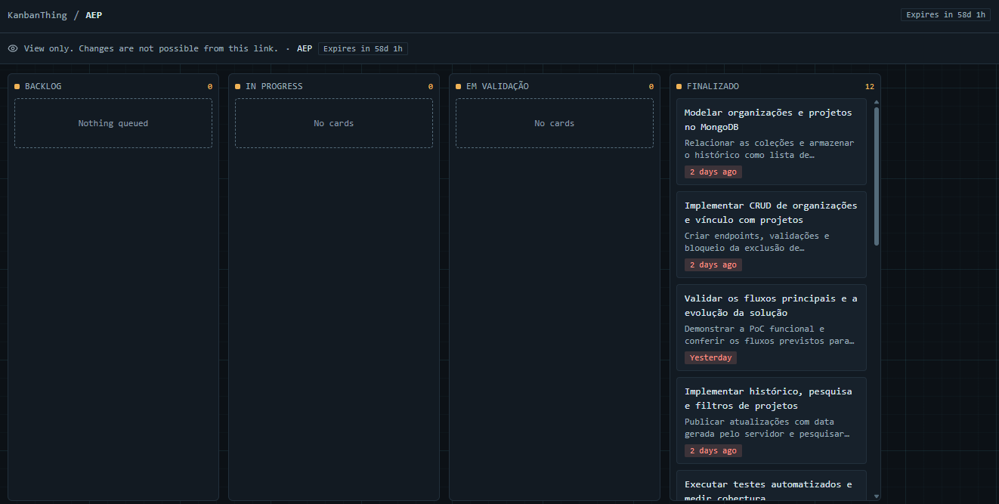

# Projetos Sociais

PoC de consulta pública e gestão de iniciativas sociais: frontend em Next.js/React/TypeScript/Tailwind, API Java 21 com Spring Boot/Spring Security e banco MongoDB. A proposta apoia o ODS 16 pelo acesso à informação e transparência.

## Objetivo e funcionalidades

A plataforma aproxima pessoas e iniciativas sociais ao reunir informações sobre projetos comunitários em um único lugar. Organizações podem divulgar seus projetos e compartilhar seu andamento, enquanto a comunidade consulta as iniciativas e os contatos disponíveis. A proposta apoia o **ODS 16**, especialmente o acesso à informação e a transparência.

As funcionalidades disponíveis incluem:

- Consulta pública de projetos, com pesquisa por nome e filtro por situação.
- Visualização dos dados da organização responsável e do histórico de atualizações de cada projeto.
- Cadastro e autenticação de responsáveis por organizações.
- Gestão de organizações e projetos associados à conta autenticada.
- Publicação de atualizações com data e hora geradas pela API.
- Validação dos dados, controle de propriedade e impedimento da exclusão de organizações com projetos vinculados.

## Tecnologias

| Componente | Tecnologias |
| --- | --- |
| Frontend | Next.js, React, TypeScript e Tailwind CSS |
| API | Java 21, Spring Boot, Spring Security e Spring Data MongoDB |
| Persistência | MongoDB |
| Documentação da API | OpenAPI e Swagger UI |
| Testes | JUnit e JaCoCo na API; Vitest e Testing Library no frontend |
| Execução | Docker e Docker Compose |

## Metodologia de desenvolvimento

Utilizamos o **Kanban** para organizar e acompanhar as tarefas do projeto, com um quadro no **KanbanThing**. O fluxo de trabalho foi dividido nas colunas **Backlog**, **In Progress**, **Em validação** e **Finalizado**, representando as tarefas planejadas, em desenvolvimento, em conferência e concluídas.

O quadro registra atividades de modelagem do MongoDB, implementação da API e do frontend, testes automatizados e validação dos fluxos da PoC. A visualização do trabalho por etapa facilita o acompanhamento das pendências e a identificação do que está em desenvolvimento, em conferência ou concluído.

O desenvolvimento foi **incremental**, em consonância com as entregas da AEP. A primeira versão, identificada pelo commit `0025812`, oferecia o CRUD de projetos. A evolução acrescentou organizações relacionadas, histórico de atualizações, filtros, autenticação por proprietário e uma interface web. O histórico Git registra essas alterações e permite acompanhar a evolução da PoC.

As atividades incluem implementação, testes automatizados e documentação. A API e o frontend possuem verificações e relatórios de cobertura próprios, descritos em [Documentação e testes](#documentação-e-testes).

[Consultar o quadro Kanban do projeto (somente leitura)](https://www.kanbanthing.com/board?view=6d5fc53d-f3f5-46c7-90f9-d80f32605fe6)




## Arquitetura de software

A solução segue uma organização **cliente-servidor**, com interface web, API REST e banco de dados MongoDB. O frontend apresenta os fluxos ao usuário e chama a API por HTTP. A API centraliza autenticação, autorização, validações e regras de negócio, além de coordenar o acesso ao banco. Essa divisão organiza responsabilidades e permite desenvolver e testar cada componente com seus próprios recursos.

```text
Navegador
   │
   ▼
Frontend Next.js / React
   │  HTTP + JSON, cookie de sessão e token CSRF
   ▼
API Spring Boot / Spring Security
   │  Controllers → Services → Repositories / MongoTemplate
   ▼
MongoDB
```

### Frontend

O App Router do Next.js organiza as rotas públicas e a área de gestão. Componentes, hooks e contexto de autenticação tratam a interface e o estado das telas. As telas utilizam o contrato `Services`, implementado pelos adaptadores HTTP e de demonstração. Essa separação concentra a comunicação com a API e permite testar a interface com serviços simulados.

### API e regras de negócio

A API usa camadas com responsabilidades distintas:

- **Controllers** recebem requisições HTTP, validam os DTOs e retornam respostas.
- **Services** aplicam regras como a verificação da organização vinculada, da propriedade dos registros e do período dos projetos.
- **Repositories e MongoTemplate** consultam e persistem documentos no MongoDB. A publicação de atualizações utiliza uma operação de inclusão no histórico.
- **DTOs e tratamento de exceções** definem os dados de entrada e saída e apresentam erros com códigos HTTP adequados.

A separação facilita a manutenção e os testes das regras. O Spring Security protege operações de escrita com autenticação por sessão, controle de acesso e CSRF. As consultas públicas permanecem disponíveis para apresentar os projetos à comunidade.

### Modelo de dados

O MongoDB armazena documentos em três coleções principais:

| Coleção | Papel no domínio |
| --- | --- |
| `usuarios` | Contas dos responsáveis, com e-mail normalizado e hash de senha. |
| `organizacoes` | Dados das organizações e referência ao usuário proprietário. |
| `projetos_sociais` | Projetos com referência à organização e uma lista de subdocumentos de atualizações. |

A referência por identificador associa cada projeto à sua organização. O histórico embutido reúne data e descrição das atualizações no documento do projeto. O [guia de migração](api/docs/migracao-organizacoes.md) descreve como tratar os projetos cadastrados antes desse relacionamento.

### Estrutura do repositório

```text
.
├── api/                  # API, testes e documentação do backend
│   ├── docs/             # Autenticação, integração e migração
│   └── src/              # Código Java e testes
├── web/                  # Aplicação Next.js, componentes e testes
├── docs/images/          # Evidência visual do quadro Kanban
├── compose.yaml          # Orquestração local dos serviços
└── .env.example          # Exemplo de configuração local
```

## Subir o projeto completo

Instale e inicie o **Docker Desktop com containers Linux** e Docker Compose. Não é necessário instalar Java, Node.js ou MongoDB no computador.

Na raiz do repositório:

```powershell
docker compose up --build -d --wait --wait-timeout 180
```

O primeiro build baixa as imagens e dependências e pode levar alguns minutos. O Dockerfile da API executa `mvnw verify`, incluindo testes unitários e a verificação JaCoCo; os testes que exigem MongoDB externo permanecem condicionados à configuração descrita na documentação da API. O frontend é compilado em modo de produção, integrado à API real.

| Serviço | Endereço |
| --- | --- |
| Frontend | http://localhost:3000 |
| API | http://localhost:8080/api/projetos |
| Swagger | http://localhost:8080/swagger-ui.html |
| MongoDB | `mongodb:27017`, somente na rede dos containers |

Use **localhost** no navegador, pois a origem CORS e a URL pública da API estão configuradas para esse endereço. Cadastre uma conta, faça login, crie uma organização e então um projeto. As atualizações publicadas aparecem na consulta pública.

Os serviços aguardam os respectivos healthchecks: MongoDB → API → frontend. API e frontend usam builds em estágios, com execução sem usuário root. O Next utiliza o artefato standalone apenas no Docker, mantendo `npm run dev` e `npm start` disponíveis no desenvolvimento local.

## Configuração e dados

Os valores padrão permitem execução local imediata. Para personalizar portas ou credenciais, copie `.env.example` para `.env` **na raiz**, antes de iniciar:

```powershell
Copy-Item .env.example .env
docker compose config --quiet
docker compose up --build -d --wait --wait-timeout 180
```

`WEB_PORT` e `API_PORT` atualizam também CORS e a URL da API incorporada ao frontend. Alterar a porta da API exige reconstruir o frontend com `--build`, pois variáveis `NEXT_PUBLIC_*` são incorporadas durante a compilação. O `.env.local` de `web` não é copiado para a imagem.

As credenciais padrão são exclusivas desta configuração local. Use caracteres alfanuméricos, `_` e `-` nas credenciais configuradas aqui, pois são interpoladas na URI. A inicialização das credenciais do MongoDB ocorre apenas na primeira criação do volume; editar `.env` não altera usuários de um banco já inicializado.

O volume `mongodb_data` preserva contas, organizações e projetos entre reinícios. `docker compose down` remove os containers e mantém os dados. Evite `down -v` se quiser preservá-los: essa opção remove também o volume do banco.

Esta configuração expõe frontend/API apenas em `127.0.0.1` e não publica a porta do banco. Ela é destinada à execução local e avaliação. Para hospedagem, configure domínio, HTTPS, origens CORS, cookie seguro e credenciais próprias.

O arquivo `api/docker-compose.yml` continua disponível para o desenvolvimento que usa apenas MongoDB/mongo-express. Ele é independente do Compose completo da raiz e usa outro volume; dados anteriores não são migrados automaticamente.

## Comandos úteis

```powershell
docker compose ps
docker compose logs -f api web
docker compose stop
docker compose start
docker compose down
```

Para reconstruir após mudanças no código, use novamente `docker compose up --build -d --wait`.

## Documentação e testes

- [API: execução, endpoints, modelagem e testes](api/README.md)
- [Frontend: estrutura, funcionalidades e testes de cobertura](web/README.md)
- [Contrato de autenticação e integração](api/docs/autenticacao-frontend.md)

O build Docker da API inclui sua suíte padrão. Para gerar o relatório do frontend localmente, execute `npm ci` e `npm run test:coverage` dentro de `web`. Os relatórios são independentes; consulte cada README para os comandos reproduzíveis e testes de integração com MongoDB.

Para executar as verificações separadamente, utilize os comandos abaixo a partir da raiz do repositório:

```powershell
# API — Java 21
cd api
.\mvnw.cmd clean verify
cd ..

# Frontend — Node.js 22.12 ou superior
cd web
npm ci
npm run test:coverage
cd ..
```

No Linux ou macOS, execute `./mvnw clean verify` dentro de `api`. O relatório da API é gerado em `api/target/site/jacoco/index.html`, e o do frontend em `web/coverage/index.html`. A API exige pelo menos 80% de cobertura de linhas e de ramificações no JaCoCo. O frontend exige pelo menos 70% de cobertura de linhas. A AEP exige cobertura mínima de 70%.

Os testes da API que dependem de um MongoDB externo são condicionados à variável `AEP_MONGODB_TEST_URI`. Para executá-los e conhecer as permissões necessárias, siga as instruções do [README da API](api/README.md). Os testes do frontend usam serviços e transporte HTTP simulados. A validação do fluxo integrado utiliza frontend, API e MongoDB em execução.

Referências de implementação: [Next.js standalone](https://nextjs.org/docs/app/api-reference/config/next-config-js/output) e [ordem de inicialização no Compose](https://docs.docker.com/compose/how-tos/startup-order/).
